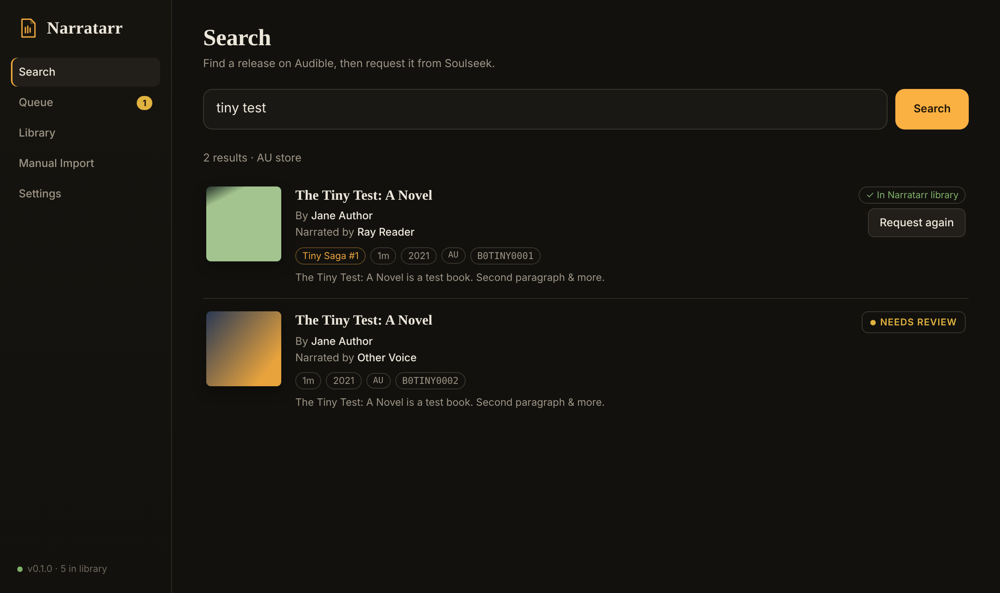
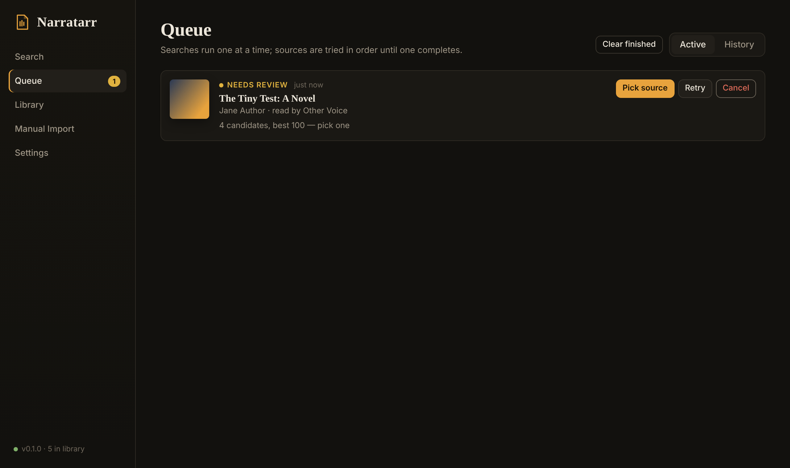
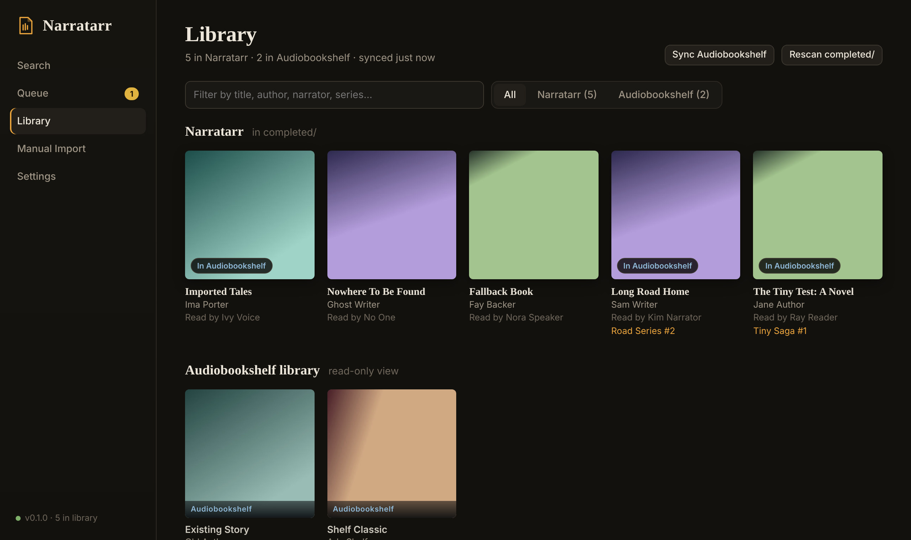
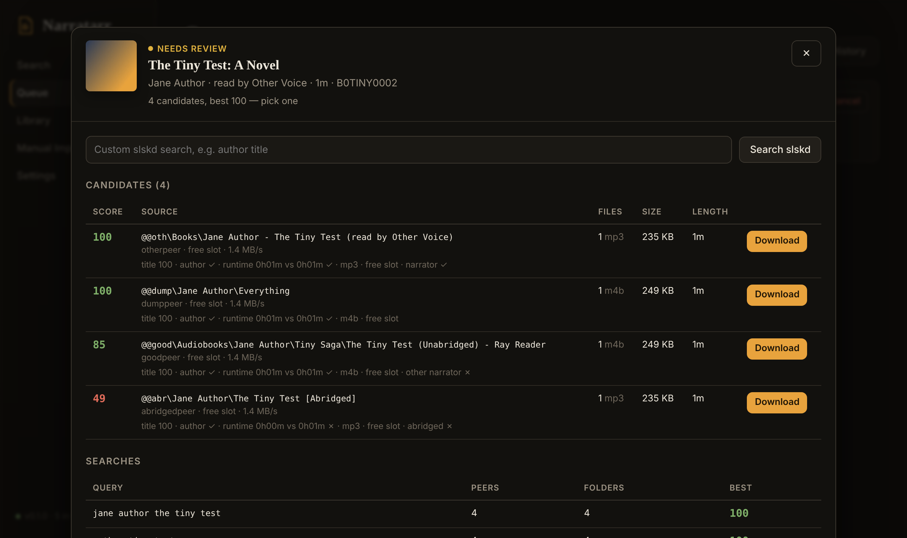

<p align="center">
  
</p>

<h1 align="center">Narratarr</h1>

<p align="center">
  Request audiobooks by their Audible release, fetch them from Soulseek through <a href="https://github.com/slskd/slskd">slskd</a>,
  and file them tagged, with covers and chapters, straight into <a href="https://www.audiobookshelf.org">Audiobookshelf</a>.
</p>

<p align="center">
  <a href="LICENSE"></a>
  <a href="https://github.com/joshbosh/narratarr/pkgs/container/narratarr"></a>
</p>

> [!WARNING]
> **This is a vibe-coded project.** AI was used to build it. It has an end-to-end test suite, but expect rough edges:
> read the code before trusting it with anything important, and keep backups of your library. Bug reports and PRs are
> very welcome.

> [!IMPORTANT]
> Narratarr is not affiliated with or endorsed by Audible, Amazon, Audnexus, Hardcover, slskd, Soulseek or Audiobookshelf. It uses
> Audible's public, unauthenticated catalogue API, which is undocumented and can change without notice. You are
> responsible for what you download: only fetch material you have the right to.



## What it does

- **Search** Audible's catalogue by title, author, narrator or ASIN. Each edition and narration is its own result, with author,
  narrator, series, runtime and region, plus whether it's already in your Audiobookshelf library.
- **Optional second source: [Hardcover](https://hardcover.app).** Audible's metadata always wins; Hardcover fills any gaps,
  adds books Audible doesn't list, and takes over if Audible doesn't respond. Off by default.
- **Request** a release and Narratarr searches slskd with progressively looser queries. It groups results by folder
  (folding `CD1`/`Disc 2` sub-folders together), fuzzy-scores them against the Audible record, and downloads the best match.
  Runtime is the strongest signal, which separates abridged editions and different narrations.
- **Falls back automatically.** A source that errors, times out or stalls is retried, then the next candidate is tried.
  If slskd itself is busy, Narratarr backs off rather than burning through sources. If another app moves a finished
  file out of slskd's folder, the rest of the book keeps downloading and you can re-download just that file.
- **Activity panel:** the bottom of the sidebar shows what's happening right now (searching, downloading,
  re-encoding, sending to Audiobookshelf), like the *arr apps.
- **Tags without renaming.** Filenames are kept as downloaded. Files get full tags (title, author, narrator, series and
  part, ASIN, description, genres, year, track and disc numbers, embedded cover). Single-file books get Audible's chapter
  list when the file has none and the length matches.
- **Hands off to Audiobookshelf.** Each finished book is moved or copied into your library folder, Audiobookshelf is
  asked to scan just that folder, the new item is matched by path, and missing metadata is filled in. Anything that
  can't finish (Audiobookshelf down, folder not mounted) waits as *pending* and retries.
- **Optional re-encode** (off by default): join a book's files into one M4B with chapters at a lean bitrate (64 kbps
  by default) using the bundled FFmpeg. It only runs when it helps, and replaces the original files.
- **Manual Import:** point it at any folder of audio, match it to an Audible release, and it gets the same treatment.

Narratarr is on-demand only: there's no author or new-release monitoring.

| Queue | Library | Picking a source |
|---|---|---|
|  |  |  |

## Quick start (Docker Compose)

### Before you start

Narratarr needs three things from slskd:

- **A running [slskd](https://github.com/slskd/slskd) instance** that's logged in to Soulseek and reachable from the Narratarr
  container.
- **An API key with the `readwrite` role.** Keys go under `web.authentication.api_keys` in `slskd.yml` (see slskd's
  [API Keys documentation](https://github.com/slskd/slskd/blob/master/docs/config.md#api-keys)). Keys added this way
  default to `readonly`, which can search but can't queue downloads, so set the role explicitly:

  ```yaml
  web:
    authentication:
      api_keys:
        narratarr:
          key: <16 to 255 random characters>
          role: readwrite
  ```

  You can generate a key with:

  ```bash
  openssl rand -hex 24
  ```

  Restart slskd after editing `slskd.yml`. You can also limit the key to your LAN with a `cidr` entry (see the same
  docs).
- **Access to slskd's downloads folder.** This is the folder set by `directories.downloads` (see
  [Incomplete and Downloads](https://github.com/slskd/slskd/blob/master/docs/config.md#incomplete-and-downloads)). By
  default it's `downloads` inside slskd's app directory, which is `/app/downloads` in the official container. Mount the
  same host folder into Narratarr at `/slskd-downloads`.

### Install

1. Create a `docker-compose.yml`:

```yaml
services:
  narratarr:
    image: ghcr.io/joshbosh/narratarr:latest
    container_name: narratarr
    restart: unless-stopped
    user: "1000:1000"            # same UID:GID that owns your slskd downloads and audiobook library
    ports:
      - "8787:8787"
    environment:
      TZ: Etc/UTC
      NARRATARR_SLSKD__URL: http://slskd:5030
      NARRATARR_SLSKD__API_KEY: change-me
    volumes:
      - ./config:/config
      - ./downloads:/downloads
      - /path/to/slskd/downloads:/slskd-downloads
      - /path/to/audiobooks:/audiobooks      # optional: your Audiobookshelf library folder
```

2. Create the folders and start it:

```bash
mkdir -p config downloads
```
```bash
docker compose up -d
```
```bash
docker compose logs -f narratarr
```

3. Open `http://<host>:8787/settings`. The path tiles at the top should all read **ok · writable**, and **Save & test**
   for slskd should report *Connected*.

Updating:

```bash
docker compose pull
```
```bash
docker compose up -d
```

Stopping:

```bash
docker compose down
```

### Plain `docker run`

```bash
docker run -d --name narratarr --restart unless-stopped \
  --user 1000:1000 -p 8787:8787 \
  -e TZ=Etc/UTC \
  -e NARRATARR_SLSKD__URL=http://slskd:5030 \
  -e NARRATARR_SLSKD__API_KEY=change-me \
  -v "$PWD/config:/config" \
  -v "$PWD/downloads:/downloads" \
  -v /path/to/slskd/downloads:/slskd-downloads \
  -v /path/to/audiobooks:/audiobooks \
  ghcr.io/joshbosh/narratarr:latest
```

If slskd runs in another compose project, put Narratarr on the same Docker network, or use the host's IP in
`NARRATARR_SLSKD__URL`.

### Building from source

```bash
git clone https://github.com/joshbosh/narratarr.git
```
```bash
cd narratarr
```
```bash
docker build -t narratarr:local .
```

Then use `image: narratarr:local` in the compose file.

## Volumes and permissions

| Container path | Purpose |
|---|---|
| `/config` | SQLite database (`narratarr.db`) with settings, queue and library. |
| `/downloads` | Narratarr's working area. `incomplete/` holds in-flight and unprocessed books; `completed/` holds tagged books not (yet) sent to Audiobookshelf. |
| `/slskd-downloads` | **slskd's completed-downloads directory** (`directories.downloads` in `slskd.yml`). Narratarr moves finished files out of here. |
| `/audiobooks` | Optional. Your Audiobookshelf library folder, ideally mounted at the **same container path Audiobookshelf uses**, so no path mapping is needed. |

Narratarr moves files out of slskd's folder and into your library, so run it as a UID:GID that can write to all of
them (`user:` in compose). This is usually the same one slskd runs as.

> [!NOTE]
> Other tools that watch slskd's completed folder, such as music auto-importers, may grab audiobook downloads before
> Narratarr does. Either exclude Narratarr's files from them, or give Narratarr its own slskd instance with its own
> downloads folder.

## slskd

- Paste the `readwrite` API key from [Before you start](#before-you-start) into *Settings → slskd* and press
  **Save & test**.
- Newer slskd versions accept a per-download destination, so Narratarr's files land in
  `<downloads>/narratarr/<job>/`. Older versions use slskd's default layout. Narratarr detects which automatically and
  finds finished files by name and size either way.

## Audiobookshelf

1. Mount your Audiobookshelf library folder into Narratarr (see above).
2. In Audiobookshelf, create an API key for an **admin** user (*Settings → API Keys*). Scans and metadata edits need admin.
3. In *Settings → Audiobookshelf*: enable it, set the URL and key, press **Save & test**, pick the **Library** and
   **Library folder**, then save. Testing again should say *files go to /audiobooks*.
4. Options:
   - **Metadata.** `fill` (default) keeps Audiobookshelf's values, fills only the empty fields from Audible, and logs any
     differences. `overwrite` makes Audible's record win.
   - **Delete from Narratarr after import.** On (default), the book is moved into Audiobookshelf. Off, it's copied and
     Narratarr keeps its own copy in `completed/`.
   - **Audiobookshelf link URL.** The address you open Audiobookshelf at in a browser, used for *Open in Audiobookshelf*
     links, if it differs from the URL Narratarr connects to.

Search shows **In Audiobookshelf library** and asks before requesting a duplicate. It matches by ASIN, or by title and
author when the Audiobookshelf item has no ASIN. The Library page shows Narratarr's books and your Audiobookshelf
library as separate sections.

Each book folder also gets `cover.jpg`, `desc.txt`, `reader.txt`, `metadata.opf` and an Audiobookshelf-format
`metadata.json`, so the scanner picks up the right metadata even without the API.

## Metadata sources

| Source | Default | Needs | Used for |
|---|---|---|---|
| Audible | On | Nothing | Primary source: search, ASIN lookups, region fallback (e.g. AU then US) |
| Audnexus | On | Nothing | Adds genres, ISBN and the chapter list to Audible results |
| [Hardcover](https://hardcover.app) | Off | A free API key | Fills gaps, adds books Audible doesn't list, backup when Audible doesn't respond |

To turn on Hardcover:

1. Sign in to Hardcover and create an API key at **[hardcover.app/account/api](https://hardcover.app/account/api)**. It's free.
2. In *Settings → Metadata*, turn on **Use Hardcover as a second source**, paste the key (with or without the `Bearer`
   prefix), and press **Save & test**.

When both sources are on, each search queries both and compares the results. Matches are paired by ASIN or ISBN, or by
title, author and narrator. For a matched book, Audible's values are kept and only empty fields (narrator, series,
description, runtime and so on) are taken from Hardcover. Books only Hardcover knows about are listed after Audible's
results. If Audible doesn't respond, searches and lookups use Hardcover on its own.

Hardcover's API is in beta. Free keys allow 60 requests a minute, and each search uses two of them. Keys expire on the
date you choose when creating them, so if searches stop returning Hardcover results, check the key first.

## How matching works

For each request Narratarr builds up to six search queries, from most to least specific. Examples: *author + short
title*, *surname + title keywords*, *title alone*, *title + narrator*, *series + number*. It runs them **one at a time**
and stops at the first result that scores above the auto-pick threshold (default 72/100).

Candidates are scored on:

| Signal | Weight | Notes |
|---|---|---|
| Title | 45% | Fuzzy match against folder and file names |
| Runtime | 25% | Total length vs Audible's runtime (±8% by default) |
| Author | 15% | Surname anywhere in the path |
| Format | 8% | Your preference order, default `m4b, mp3, m4a, flac, opus, ogg` |
| Availability | 7% | Free upload slot, queue length, speed |

Size counts a little too: copies above 160 kbps lose a few points, and ones below 32 kbps lose more, so a lean
copy wins between two equally good matches. It's never enough to make a partial or wrong copy win over a complete one.

Penalties apply for another narrator of the same title, *abridged* or *dramatised* versions, samples, and a different
series number. Results below the threshold wait in **Needs review**, where you can see each candidate's score with the
reasons and pick one, or run a custom search.

## Configuration

Everything is configured on the **Settings** page and stored in `/config/narratarr.db`. Any setting can be given a
first-run default with an environment variable. The variable only applies until the setting is saved in the UI.

| Variable | Setting | Default |
|---|---|---|
| `NARRATARR_SLSKD__URL` | slskd URL | `http://slskd:5030` |
| `NARRATARR_SLSKD__API_KEY` | slskd API key | |
| `NARRATARR_SLSKD__DOWNLOADS_PATH` | slskd downloads folder | `/slskd-downloads` |
| `NARRATARR_SLSKD__SEARCH_SECONDS` | Search window (seconds) | `25` |
| `NARRATARR_SLSKD__RESPONSE_LIMIT` | Max responses per search | `250` |
| `NARRATARR_SLSKD__MAX_PEER_QUEUE` | Max peer queue length | `50` |
| `NARRATARR_SLSKD__STALL_MINUTES` | Stalled download timeout (minutes) | `45` |
| `NARRATARR_SLSKD__CLEANUP` | Clear finished transfers & searches from slskd | `true` |
| `NARRATARR_METADATA__PROVIDER` | Lookup provider | `audible` |
| `NARRATARR_METADATA__REGION` | Primary Audible region | `us` |
| `NARRATARR_METADATA__FALLBACK_REGION` | Fallback Audible region | |
| `NARRATARR_METADATA__USE_AUDNEXUS` | Enrich with Audnexus (genres, chapters) | `true` |
| `NARRATARR_METADATA__AUDNEXUS_URL` | Audnexus URL | `https://api.audnex.us` |
| `NARRATARR_METADATA__HARDCOVER_ENABLED` | Use Hardcover as a second source | `false` |
| `NARRATARR_METADATA__HARDCOVER_TOKEN` | Hardcover API key | |
| `NARRATARR_MATCHING__MIN_SCORE` | Auto-pick threshold (0-100) | `72` |
| `NARRATARR_MATCHING__MAX_QUERIES` | Max search variations per book | `6` |
| `NARRATARR_MATCHING__FORMATS` | Formats (preferred first) | `m4b,mp3,m4a,flac,opus,ogg` |
| `NARRATARR_MATCHING__RUNTIME_TOLERANCE` | Runtime tolerance (%) | `8` |
| `NARRATARR_MATCHING__AUTO_DOWNLOAD` | Download best match automatically | `true` |
| `NARRATARR_PATHS__DOWNLOADS` | Downloads root | `/downloads` |
| `NARRATARR_PATHS__TEMPLATE` | Folder template | `{author}/{series}/{seqtitle}` |
| `NARRATARR_PATHS__IMPORT_ROOTS` | Extra Manual Import folders | |
| `NARRATARR_PROCESSING__WRITE_TAGS` | Write audio tags | `true` |
| `NARRATARR_PROCESSING__EMBED_COVER` | Embed cover art in files | `true` |
| `NARRATARR_PROCESSING__SAVE_COVER` | Save cover.jpg | `true` |
| `NARRATARR_PROCESSING__EMBED_CHAPTERS` | Embed chapters in single-file books | `true` |
| `NARRATARR_PROCESSING__REENCODE` | Re-encode to a single M4B | `false` |
| `NARRATARR_PROCESSING__REENCODE_KBPS` | Re-encode bitrate (kbps) | `64` |
| `NARRATARR_PROCESSING__SIDECARS` | Write metadata.opf / metadata.json / desc.txt / reader.txt | `true` |
| `NARRATARR_ABS__ENABLED` | Send finished books to Audiobookshelf | `false` |
| `NARRATARR_ABS__URL` | Audiobookshelf URL | `http://audiobookshelf:80` |
| `NARRATARR_ABS__PUBLIC_URL` | Audiobookshelf link URL | |
| `NARRATARR_ABS__TOKEN` | API key | |
| `NARRATARR_ABS__LIBRARY_ID` | Library | |
| `NARRATARR_ABS__FOLDER_ID` | Library folder | |
| `NARRATARR_ABS__LOCAL_PATH` | That folder, as mounted in Narratarr | |
| `NARRATARR_ABS__METADATA_MODE` | Metadata | `fill` |
| `NARRATARR_ABS__DELETE_AFTER_IMPORT` | Delete from Narratarr after import | `true` |
| `NARRATARR_ABS__SYNC_MINUTES` | Library sync interval (minutes) | `15` |
| `NARRATARR_GENERAL__POLL_SECONDS` | Download poll interval (seconds) | `5` |
| `NARRATARR_AUTH__MODE` | Authentication | `none` |

Other environment variables:

| Variable | Purpose | Default |
|---|---|---|
| `NARRATARR_DATA_DIR` | Where the database lives | `/config` |
| `NARRATARR_LOG_LEVEL` | Python log level | `INFO` |
| `TZ` | Container time zone | `Etc/UTC` |

The folder template supports `{author} {title} {series} {seq} {seqtitle} {narrator} {year} {asin}`. Empty segments are
dropped, so books without a series skip that level.

## Security

There is **no authentication yet**. Don't expose Narratarr directly to the internet: keep it on your LAN, or put it
behind a reverse proxy with authentication, or behind a VPN. Every API route already goes through a single auth hook
(`app/auth.py`), so login support can be added without restructuring.

## Development

```bash
python -m venv .venv
```
```bash
. .venv/bin/activate
```
```bash
pip install -r requirements.txt
```
```bash
python tests/e2e.py
```

The end-to-end suite starts mock Audible, Audnexus, slskd and Audiobookshelf servers (`tests/mocks/mock_server.py`) and
runs real scenarios against them: narrator-specific matching, multi-disc books, failing and busy sources, manual picks,
manual import, region fallback, and the full Audiobookshelf hand-off. It needs `ffmpeg` on your PATH. On Windows,
use `.venv\Scripts\python.exe` in place of `python`.

To run the app against the mocks and click around, see the environment variables used in `tests/e2e.py`.

```
app/
  main.py          FastAPI app and SPA routing
  api.py           HTTP API (all routes behind auth.current_user)
  auth.py          auth seam (none for now)
  config.py        settings schema; the Settings page is generated from it
  db.py            SQLite with forward-only migrations
  jobs.py          pipeline: search → download → process → Audiobookshelf
  matching.py      query variations, grouping, scoring
  slskd.py         slskd API client
  postprocess.py   organise, cover, sidecars
  tagging.py       mutagen tagging and chapter embedding
  library.py       library rescan, import folder discovery
  providers/       metadata sources (Audible, Audnexus, Hardcover); add new ones here
  integrations/    Audiobookshelf
web/               index.html, app.js, style.css (no build step)
tests/             e2e.py and mock services
```

## Roadmap

- Authentication (local accounts, or trusted reverse-proxy headers)
- Collision detection with other apps that share slskd (e.g. DroppedNeedle, Soularr): detect when another tool
  grabs or moves Narratarr's downloads from slskd's completed folder, warn about it, and recover the files
- Support for other download clients alongside slskd, such as torrent clients (qBittorrent, Transmission) and Usenet
  (SABnzbd, NZBGet), with indexers via Prowlarr
- More metadata providers
- Live updates over SSE instead of polling

## Acknowledgements

[slskd](https://github.com/slskd/slskd), [Audiobookshelf](https://github.com/advplyr/audiobookshelf),
[Audnexus](https://github.com/laxamentumtech/audnexus) and [Hardcover](https://hardcover.app), which this builds on. Also the
*arr projects for the general idea.

## License

Narratarr's own code is released under the [MIT License](LICENSE).

It depends on third-party software under its own licenses. Most notably, [mutagen](https://github.com/quodlibet/mutagen)
is GPL-2.0-or-later, and the Docker image includes [FFmpeg](https://ffmpeg.org/legal.html) (GPL build from Debian). The
published Docker image as a whole is therefore distributed under the terms of those licenses as well.
